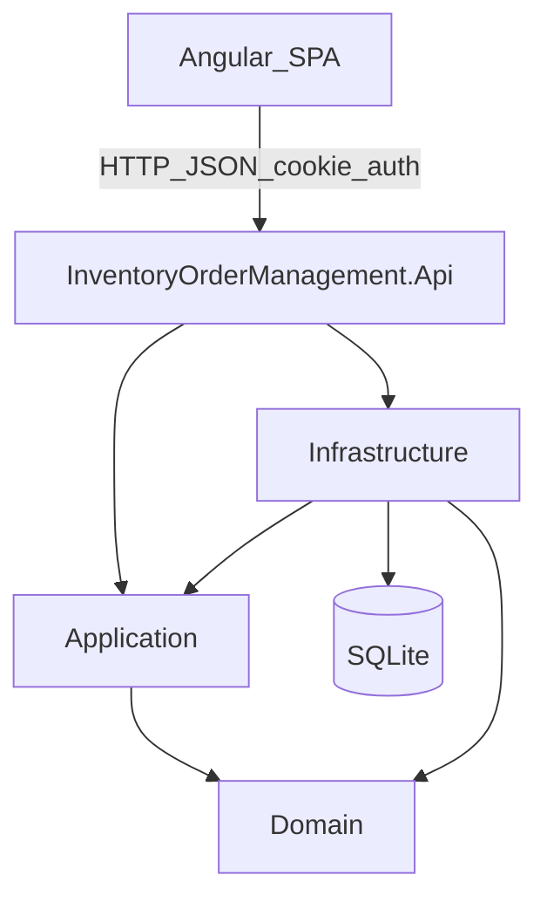

# InventoryOrderManagement

Full-stack Inventory, Purchasing, and Sales Management System.

A portfolio application that demonstrates software engineering practices, Clean Architecture, and end-to-end integration between a .NET 10 REST API and an Angular 22 SPA.

<p>
  
  
  
  
  
  
  
  
  
  
  
</p>

Badges from [Badges4-README.md-Profile](https://github.com/alexandresanlim/Badges4-README.md-Profile).

---

## Table of contents

- [About](#about)
- [Technical goals](#technical-goals)
- [Tech stack](#tech-stack)
- [Architecture](#architecture)
- [Repository structure](#repository-structure)
- [Features](#features)
- [Prerequisites](#prerequisites)
- [Run the backend](#run-the-backend)
- [Run the frontend](#run-the-frontend)
- [Environment configuration](#environment-configuration)
- [Database and migrations](#database-and-migrations)
- [API documentation](#api-documentation)
- [Authentication and authorization](#authentication-and-authorization)
- [Automated tests](#automated-tests)
- [Screenshots](#screenshots)
- [Architectural decisions](#architectural-decisions)
- [Roadmap](#roadmap)
- [Skills demonstrated](#skills-demonstrated)
- [License and contributing](#license-and-contributing)
- [Author](#author)

---

## About

**InventoryOrderManagement** is a full-stack system for operational management of catalog, inventory, purchases, sales, finance, returns/exchanges, and shipping/delivery.

It addresses the basic flow of a business that needs to:

- manage products, categories, suppliers, and customers;
- control stock receipts, issues, and minimum levels;
- register purchase orders and sales orders;
- track financial titles and cash movements;
- handle customer/supplier returns and the shipping lifecycle;
- administer users, roles, and permissions.

The audience is developers, technical recruiters, and reviewers looking for a full-stack portfolio with emphasis on architecture and code quality.

The goal is to apply Clean Architecture, DDD where applicable, REST APIs, an Angular SPA, and automated tests end to end — not to ship a complete enterprise ERP.

---

## Technical goals

| Concept | How it shows up in this repo |
|---|---|
| Clean Architecture | Domain, Application, Infrastructure, and Api layers, with Domain free of frameworks |
| SOLID | Focused use cases, dependency injection, and persistence abstractions |
| OOP / Clean Code | Encapsulated entities, explicit state transitions, domain-oriented naming |
| DDD (where applicable) | Aggregates (`Order`, `PurchaseOrder`, `Shipment`, `ReturnRequest`, `FinancialTitle`), value objects, and invariants |
| Design patterns | Repository, Unit of Work, domain factory methods, Api as composition root |
| REST API | ASP.NET Core controllers, permission policies, ProblemDetails |
| EF Core 10 | Fluent mappings, migrations, SQLite provider |
| Angular standalone components | Feature modules without classic NgModules |
| Reactive Forms | Create/edit and workflow forms across features |
| Signals and RxJS | Reactive UI state and typed HTTP flows |
| AuthN / AuthZ | ASP.NET Core Identity cookies, permission claims, Angular guards |
| Automated tests | xUnit on the backend, Vitest on the frontend |

---

## Tech stack

### Backend

| Technology | Purpose |
|---|---|
| C# | Primary language |
| .NET 10 (`net10.0`) | Runtime platform |
| ASP.NET Core Web API | REST hosting, middleware, OpenAPI |
| Entity Framework Core 10 | ORM and migrations |
| ASP.NET Core Identity (EF) | Users, roles, claims |
| SQLite | Local relational storage |
| Swashbuckle / OpenAPI | Interactive API docs in Development |
| xUnit | Unit and integration tests |

### Frontend

| Technology | Purpose |
|---|---|
| Angular 22 | SPA framework |
| TypeScript | Static typing |
| Tailwind CSS 4 | Utility-first styling + design tokens |
| Inter (`@fontsource/inter`) | Self-hosted UI typography |
| `@ngx-translate` | Runtime bilingual UI (`pt-BR` default / `en`) |
| Angular Router | Navigation and lazy-loaded features |
| Reactive Forms | Forms and validation |
| Signals and RxJS | Local state and async streams |
| Chart.js | Charts in reports/finance |
| Vitest + jsdom | Angular unit tests |

### Tooling

| Tool | Purpose |
|---|---|
| Git / GitHub | Version control and hosting |
| .NET CLI | Restore, build, run, `dotnet ef` |
| npm | Frontend dependencies and scripts |
| Visual Studio / VS Code | IDE |

There is currently no Docker setup and no GitHub Actions workflow in this repository.

---

## Architecture

### Backend layers

| Project | Responsibility |
|---|---|
| `InventoryOrderManagement.Api` | Controllers, HTTP authZ, OpenAPI/Swagger, CORS, exception handling, composition root |
| `InventoryOrderManagement.Application` | Use cases, DTOs, persistence/identity abstractions, permissions |
| `InventoryOrderManagement.Domain` | Entities, enums, value objects, domain exceptions, business rules |
| `InventoryOrderManagement.Infrastructure` | EF Core, SQLite, repositories, Identity, seeding, concrete adapters |

Real dependency direction:

- **Api** → Application + Infrastructure
- **Infrastructure** → Application + Domain
- **Application** → Domain
- **Domain** → no dependency on other solution layers



### Request flow

1. The Angular client sends an authenticated HTTP request (`withCredentials`) to `/api/...`.
2. The Api validates authentication, antiforgery (mutations), and permission policies.
3. The controller delegates to an Application use case.
4. The use case loads aggregates, applies Domain rules, and persists through Unit of Work / repositories.
5. Infrastructure runs EF Core against SQLite.
6. The Api returns a DTO or ProblemDetails to the client.

---

## Repository structure

```text
InventoryOrderManagement/
│
├── InventoryOrderManagementServer/
│   ├── InventoryOrderManagement.Api/
│   ├── InventoryOrderManagement.Application/
│   ├── InventoryOrderManagement.Domain/
│   ├── InventoryOrderManagement.Infrastructure/
│   ├── InventoryOrderManagement.Domain.UnitTests/
│   ├── InventoryOrderManagement.Application.UnitTests/
│   ├── InventoryOrderManagement.Api.IntegrationTests/
│   ├── InventoryOrderManagement.Infrastructure.IntegrationTests/
│   └── InventoryOrderManagement.slnx
│
├── InventoryOrderManagementClient/
│   └── inventory-order-management-web/
│       ├── src/app/features/
│       ├── src/environments/
│       ├── package.json
│       └── angular.json
│
├── .gitignore
└── README.md
```

- **Server**: .NET solution with Clean Architecture and test projects.
- **Client**: Angular standalone SPA with domain features (`products`, `orders`, `shipping`, `finance`, and others).

---

## Features

Legend: **Implemented** means Backend and Frontend exist and can be used together in the current codebase.

| Module | Status | Description |
|---|---|---|
| Product Management | Implemented | Product catalog |
| Category Management | Implemented | Active/inactive categories |
| Supplier Management | Implemented | Suppliers and deactivation |
| Customer Management | Implemented | Individual and company customers |
| Inventory Management | Implemented | Balances, movements, minimum stock |
| Order Management | Implemented | Sales orders (Draft → Confirmed → Shipped → Delivered / Cancelled) |
| Purchase Management | Implemented | Purchase orders, send, receive, cancel |
| Stock / Sales Reports | Implemented | Reports and indicators via API + Angular feature |
| User and Access Management | Implemented | Users, roles, permissions, security audit |
| Finance Management | Implemented | Payables, receivables, cash accounts, cash flow, settlements, aging |
| Returns & Exchanges | Implemented | Customer/supplier returns and workflows |
| Shipping & Delivery | Implemented | Shipments, dispatch, in-transit, failure, resume, delivery |
| Notification & Alert Management | Implemented | In-app bell, unread count, notification center, mark-read (API titles/messages are English) |

---

## Prerequisites

### Backend

- [.NET SDK 10](https://dotnet.microsoft.com/download) (TargetFramework `net10.0`)
- EF Core CLI (`dotnet tool install --global dotnet-ef`) if you create/apply migrations manually

### Frontend

- Node.js compatible with Angular 22 (current LTS recommended, typically Node 20+)
- npm (the project declares `packageManager: npm@12.2.0`)

---

## Run the backend

```bash
cd InventoryOrderManagementServer

dotnet restore InventoryOrderManagement.slnx
dotnet build InventoryOrderManagement.slnx
dotnet run --project InventoryOrderManagement.Api --launch-profile http
```

With the `http` profile (`Properties/launchSettings.json`):

- API: `http://localhost:5237`
- Swagger UI (Development): `http://localhost:5237/swagger`

In Development the Api:

1. applies EF migrations automatically;
2. runs Identity seeding (optional bootstrap admin via User Secrets);
3. runs `DevelopmentDataSeeder` (catalog, operations, demo accounts).

Alternate `https` profile: `https://localhost:7265` and `http://localhost:5237`.

---

## Run the frontend

```bash
cd InventoryOrderManagementClient/inventory-order-management-web

npm install
npm start
```

`npm start` runs `ng serve`.

- Default Angular URL: `http://localhost:4200`
- Development API base URL: `http://localhost:5237/api` (`src/environments/environment.ts`)

Keep Backend and Frontend running together. CORS allows `http://localhost:4200` / `https://localhost:4200` with credentials.

---

## Environment configuration

### Backend

`InventoryOrderManagement.Api/appsettings.json`:

```json
{
  "ConnectionStrings": {
    "DefaultConnection": "Data Source=inventory.db"
  }
}
```

SQLite file `inventory.db` is created in the Api working directory. Local databases are ignored by Git (`*.db`, `*.db-shm`, `*.db-wal`).

Optional administrator bootstrap via **User Secrets** or environment variables (never committed in `appsettings.json`):

```text
Identity:Bootstrap:Email
Identity:Bootstrap:Password
Identity:Bootstrap:DisplayName
```

### Frontend

`src/environments/environment.ts`:

```ts
export const environment = {
  production: false,
  apiUrl: 'http://localhost:5237/api',
};
```

The client uses authentication cookies and the `X-XSRF-TOKEN` antiforgery header on mutating requests.

---

## Database and migrations

Persistence uses **SQLite** through EF Core 10. Migrations live under:

`InventoryOrderManagement.Infrastructure/Persistence/Migrations/`

### Automatic apply

In Development, `Program.cs` calls `dbContext.Database.Migrate()` on startup.

### CLI (`dotnet ef`)

```bash
cd InventoryOrderManagementServer

dotnet ef migrations add MigrationName \
  --project InventoryOrderManagement.Infrastructure \
  --startup-project InventoryOrderManagement.Api

dotnet ef database update \
  --project InventoryOrderManagement.Infrastructure \
  --startup-project InventoryOrderManagement.Api
```

### Package Manager Console (Visual Studio)

```powershell
Add-Migration MigrationName `
  -Project InventoryOrderManagement.Infrastructure `
  -StartupProject InventoryOrderManagement.Api

Update-Database `
  -Project InventoryOrderManagement.Infrastructure `
  -StartupProject InventoryOrderManagement.Api
```

Do not commit the physical database file; rely on migrations and seeding.

---

## API documentation

With the Api running in Development:

| Resource | URL |
|---|---|
| Swagger UI | `http://localhost:5237/swagger` |
| Endpoint prefix | `/api` |

Representative groups (not exhaustive):

| Area | Examples |
|---|---|
| Auth | `POST /api/auth/login`, `POST /api/auth/logout`, `GET /api/auth/me`, `GET /api/auth/csrf` |
| Catalog | `/api/products`, `/api/categories`, `/api/suppliers`, `/api/customers` |
| Operations | `/api/inventory`, `/api/orders`, `/api/purchase-orders` |
| Shipping | `/api/shipments` |
| Returns | `/api/returns` |
| Finance | `/api/payables`, `/api/receivables`, `/api/cash-accounts`, … |
| Security | `/api/users`, `/api/roles`, `/api/permissions`, `/api/security-audit` |

Errors follow `ProblemDetails`. Enums are serialized as strings (`JsonStringEnumConverter`).

---

## Authentication and authorization

### Mechanism

- **ASP.NET Core Identity** with auth cookie (`.Iom.Auth`)
- Antiforgery cookie (`.Iom.Antiforgery`) + `X-XSRF-TOKEN` header
- Authorization by **permission claims** (named policies such as `Orders.View`, `Shipments.Dispatch`)
- Fallback policy requires an authenticated user
- Must-change-password middleware (`MustChangePasswordMiddleware`)

### System roles

`Administrator`, `Manager`, `InventoryOperator`, `SalesOperator`, `Viewer` — permission defaults in `RolePermissionDefaults`.

### Frontend

- Login at `/login`
- Auth guards and `permissionGuard`
- `*hasPermission` directive for UI gating (server-side policies remain the security boundary)

### Demo accounts (Development only)

`DevelopmentDataSeeder` creates demo sign-in accounts for local exploration. Details live in:

`InventoryOrderManagement.Infrastructure/Persistence/Seeding/DevelopmentDataSeeder.cs`

It also seeds in-app notifications (low stock, order confirmed, shipment failed, return awaiting inspection) for each active demo user, so the Navbar bell and `/notifications` page can be exercised after login.

Use them only for local Development / portfolio demos — never in production.

---

## Automated tests

### Backend (xUnit)

| Project | Scope |
|---|---|
| `InventoryOrderManagement.Domain.UnitTests` | Entity rules and transitions |
| `InventoryOrderManagement.Application.UnitTests` | Use cases |
| `InventoryOrderManagement.Api.IntegrationTests` | HTTP endpoints via `WebApplicationFactory` |
| `InventoryOrderManagement.Infrastructure.IntegrationTests` | Persistence / infrastructure scenarios |

```bash
cd InventoryOrderManagementServer

dotnet test InventoryOrderManagement.slnx
```

Example filter:

```bash
dotnet test InventoryOrderManagement.Api.IntegrationTests --filter "FullyQualifiedName~Shipment"
```

### Frontend (Vitest via Angular)

```bash
cd InventoryOrderManagementClient/inventory-order-management-web

npm test
```

Example include:

```bash
npx ng test --watch=false --include=**/shipping/**/*.spec.ts
```

This README does not claim coverage percentages or continuous-run results; run the commands above in your environment.

---

## Screenshots

There is no versioned `docs/images` folder with official captures yet.

Suggested layout when you add them:

```text
docs/images/
  products.png
  inventory.png
  orders.png
  shipping.png
  finance.png
```

Example markdown after real files exist:

```markdown
### Orders


```

---

## Architectural decisions

- **Layer separation**: business rules in Domain; orchestration in Application; EF/Identity details in Infrastructure.
- **Encapsulation**: private setters and explicit transition methods (`Confirm`, `Dispatch`, `MarkAsDelivered`, …).
- **DTOs**: Application contracts; controllers do not expose domain entities.
- **Repository + Unit of Work**: persistence abstraction and atomic transactions (for example, dispatch syncs Shipment and Order).
- **Centralized exception handling**: `GlobalExceptionHandler` maps domain exceptions to HTTP (400/404/409…).
- **Fine-grained permissions**: claim policies reused by the Angular UI.
- **Idempotent seeding**: `DevelopmentDataSeeder` is safe to re-run in Development.
- **Feature-based frontend**: typed HTTP services, lazy routes, reactive forms, inline status banners.
- **Order × Shipment consistency**: when a shipment exists, legacy order ship/deliver returns 409 and the UI routes to the shipping workflow.

---

## Roadmap

Items not present yet or candidates for evolution (no delivery commitment):

- CI/CD with GitHub Actions
- Docker Compose packaging (Api + SPA)
- Broader automated test coverage (Application / API / Angular)
- Official screenshots under `docs/images`
- Formal `LICENSE` file
- Hardened configuration for non-Development environments

---

## Skills demonstrated

### Backend

- REST APIs with ASP.NET Core and .NET 10
- Clean Architecture and SOLID
- Domain modeling and invariants
- EF Core 10 + SQLite + migrations
- Identity, cookies, antiforgery, permission-based authorization
- Transactions, optimistic concurrency, ProblemDetails
- Unit and integration tests with xUnit

### Frontend

- Angular 22 standalone
- TypeScript, Reactive Forms, Signals, RxJS
- Tailwind CSS 4 design system (blue / green / orange tokens) and Inter typography
- Branding assets under `InventoryOrderManagementClient/inventory-order-management-web/public/assets/branding/` (logo mark from the app icons)
- Bilingual UI via `@ngx-translate` (`pt-BR` default, runtime `EN` switch; currency remains **BRL**)
- Translation catalogs in `public/assets/i18n/`
- Router guards and permissions
- Cookie-based REST integration
- Vitest unit tests

---

## License and contributing

### License

There is no `LICENSE` file at the repository root. The license is **not defined yet**.

### Contributing

1. Fork the repository.
2. Create a semantic branch (`feature/...`, `fix/...`).
3. Implement the change while preserving the existing architecture.
4. Run the relevant Backend and Frontend tests.
5. Open a Pull Request describing the problem and the solution.

---

## Author

**Pedro Lustosa**

- GitHub: [Pedrolustosa](https://github.com/Pedrolustosa)
- Repository: [InventoryOrderManagement](https://github.com/Pedrolustosa/InventoryOrderManagement)

> Optionally add LinkedIn or a public email here for your portfolio profile.
