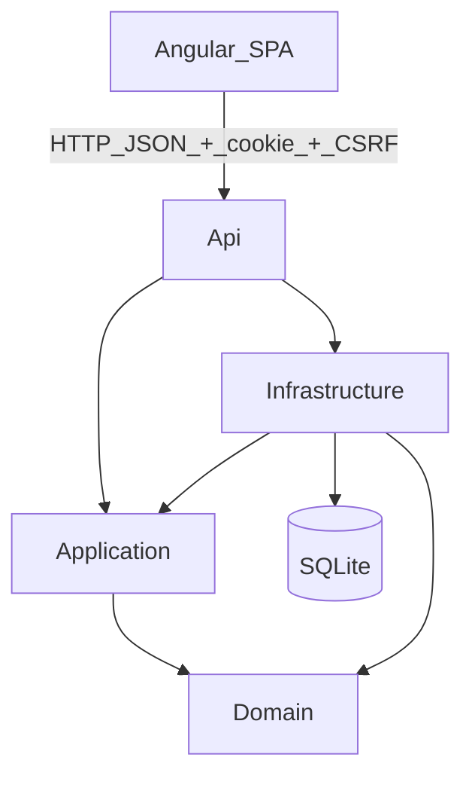
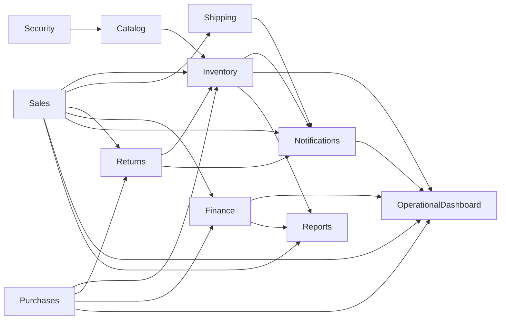

# Architecture

## System goal

Full-stack portfolio application for operational management: catalog, inventory, sales/purchase orders, shipping, returns, finance, operational dashboard, and access administration.

The emphasis is Clean Architecture, explicit domain rules, and cookie-based REST integration between Angular and ASP.NET Core — not a complete enterprise ERP.

## Layered view

### Dependency direction

| Layer | Depends on | Responsibility |
|-------|------------|----------------|
| **Api** | Application, Infrastructure | Controllers, CORS, Swagger, policies, composition root |
| **Application** | Domain | Use cases, DTOs, abstractions, permission catalog |
| **Domain** | — | Entities, enums, value objects, invariants |
| **Infrastructure** | Application, Domain | EF Core, Identity, repositories, seed, queries |

Domain does not reference frameworks. EF/Identity details stay in Infrastructure.

## Request flow

1. The Angular SPA sends `HttpClient` requests with `withCredentials` to `/api/...`.
2. For mutations (POST/PUT/PATCH/DELETE), the interceptor sends the `X-XSRF-TOKEN` header.
3. The Api authenticates the Identity cookie, validates antiforgery, and applies the permission policy.
4. The controller delegates to an Application use case.
5. The use case loads aggregates, applies Domain rules, and persists through Unit of Work / repositories.
6. Infrastructure runs EF Core against SQLite.
7. The Api returns a DTO or `ProblemDetails`.

## Client ↔ Server boundary

| Aspect | Contract |
|--------|----------|
| Transport | HTTP JSON |
| AuthN | Cookie `.Iom.Auth` (ASP.NET Core Identity) |
| CSRF | Cookie `.Iom.Antiforgery` + `X-XSRF-TOKEN` header |
| AuthZ | `permission` claims mapped to named policies |
| Errors | `ProblemDetails` (RFC 7807-like) |
| Enums | Serialized as strings |
| CORS (dev) | `http(s)://localhost:4200` with credentials |

## Business modules

| Module | Backend | Frontend |
|--------|---------|----------|
| Products, categories, suppliers, customers | Controllers + use cases | Lazy features `/products`, `/categories`, … |
| Inventory | Movements, balances, minimum stock | `/inventory` |
| Sales orders | Draft→…→Delivered state machine | `/orders` |
| Purchase orders + receipts | Send/Receive/Cancel | `/purchases` |
| Shipping | Shipment synced with Order | `/shipping` |
| Returns | Customer and supplier flows | `/returns` |
| Finance | Titles, cash, aging | `/finance` |
| Operational dashboard | `IDashboardQuery` + `/api/dashboard/*` | `/dashboard` (home surface; `Reports.View`) |
| Reports | Dedicated stock/sales queries | `/reports` (separate from `/dashboard`) |
| Users / roles / audit | Identity + audit log | `/users`, `/roles`, `/permissions`, `/audit` |
| In-app notifications | Permission-based dispatcher | Navbar + `/notifications` |

## Aggregates and consistency

Notable decisions:

- **Encapsulation**: private setters; transitions via methods (`Confirm`, `Dispatch`, `MarkAsDelivered`, …).
- **Order × Shipment**: when a shipment exists, legacy order ship/deliver returns conflict (409); the UI routes to the shipping workflow.
- **Inventory**: `InventoryBalance` with optimistic concurrency (`Version`); insufficient stock raises a domain exception.
- **Unit of Work**: composite operations (e.g. dispatch updating Shipment and Order) in one transaction.
- **Finance**: title status is derived; settlement may create a `CashMovement`.
- **Returns**: financial treatment records intent; it does not auto-create titles.

## Recurring patterns

| Pattern | Where it appears |
|---------|------------------|
| Repository + Unit of Work | Application abstractions → Infrastructure |
| One use case per operation | Scoped classes in Application (no MediatR) |
| Factory / transition methods | Domain entities |
| Composition root | `src/InventoryOrderManagement.Api/Program.cs` |
| Feature-based SPA | `src/app/features/*` with lazy routes |
| Permission-based UI | Guards + `*hasPermission` (real boundary on the server) |

## Deliberately out of scope

- Docker Compose / CI (GitHub Actions) not versioned yet
- Hardened production configuration (HTTPS redirect outside Development, secrets, etc.)
- Full ERP (tax, multi-company, advanced WMS)

See also: [Backend](backend.md), [Frontend](frontend.md), [API](api.md).
